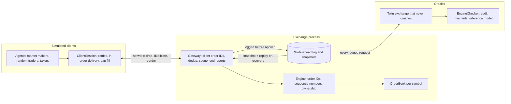

# deterministic-matching-engine

[](https://github.com/danielbrown-dev/deterministic-matching-engine/actions/workflows/ci.yml)

A price-time priority matching engine whose correctness is checked by a deterministic
simulation harness: every run is a pure function of a seed, so any failure found among
millions of simulated orders replays exactly.

- **Exchange:** limit, IOC and market orders across multiple symbols, self-trade
  prevention, and a gateway with exactly-once order entry and sequenced, resendable
  reports. A write-ahead log and snapshots provide crash recovery.
- **Simulator:** simulated traders on a simulated clock, over a network that drops,
  duplicates and reorders messages, against an exchange that crashes at arbitrary
  points, including between logging a request and applying it.
- **Checks:** after every step, two independent oracles, structural invariants, a
  never-crashing twin of the exchange, and end-to-end exactly-once and liveness checks.
  Six planted bugs, from the order book up to process supervision, are each caught
  within a few thousand steps and replayed exactly.

Pure Python 3.12+, no runtime dependencies, `mypy --strict`, 97% test coverage.

## Quick start

```sh
uv sync
uv run python -m dme.sim --seed 7 --steps 100000                  # one simulation
uv run python -m dme.sim --seeds 0:100 --steps 5000 --faults all  # network faults and crashes
uv run python -m dme.sim --bugs                                   # plant each known bug, watch it get caught
uv run python -m dme.bench                                        # throughput and latency
```

## Architecture



The core is single-threaded and does no I/O: the book, the engine and the gateway are
deterministic state machines whose output is a pure function of their input. Every
source of nondeterminism (time, randomness, the network, crashes) lives in the
simulator, where it is driven by the seed. That one design decision is what makes the
rest possible: exact replay of failures, a twin exchange to compare against, and
recovery by replaying a log.

## How correctness is checked

| Layer | Check |
| --- | --- |
| Order book | A **reference model**, a deliberately naive matcher, must produce identical events and books. **Structural invariants** cover sorted levels, linked lists, cached totals, the ID index, and a book that is never crossed. |
| Event stream | An **audit** that never looks inside the book: quantity is conserved, trades only hit resting orders at their price and within the taker's limit, no trader trades with itself, self-trade prevention cancels exactly what its mode says, and only owners can cancel. |
| Engine | Contiguous sequence numbers; rejected cancels reveal nothing; the owner index matches the books exactly. |
| Crash recovery | A **twin exchange that never crashes** handles each request the moment it is logged. The live exchange must send exactly the twin's reports, and after every recovery its state must equal the twin's. |
| Protocol | No client order is accepted twice. Each client processes exactly the next report in its stream. |
| Liveness | No request goes unanswered for more than 100 ms of simulated time. |
| End to end | When faults stop and the network drains, every client's view of its orders must match the exchange. |

The same checks run in example tests, seeded random tests, Hypothesis stateful tests,
and the simulator. Each oracle has tests that corrupt state on purpose to show it fires.
CI simulates fixed seeds with and without faults on every change, and a nightly job runs
100 fresh seeds in each fault mode. The same seed always produces the same SHA-256 digest
of the run, and a test checks this across processes with different `PYTHONHASHSEED`s.

### Planted bugs

`python -m dme.sim --bugs` plants each bug from the catalogue in `dme/sim/bugs.py` and
reports where the checks caught it (seed 0):

```
bug                   faults   caught at  check that fired
stale-level-total     none           120  level 996 cached totals are stale
owner-index-leak      none         2,137  owner index keeps non-resting order 1040
no-dedup              net              2  client order (7, 1) accepted twice
recovery-skips-last   crash          218  recovered state differs from the shadow exchange
client-no-dedup       net             10  client 7 processed Report(trader=7, seq=2, client_order_id=1
lost-restart          crash          218  trader 7 has waited 100403us for a reply
```

Every failure prints a command that replays it exactly:

```
seed=0 failed at log position 2 (t=473us): InvariantViolation: client order (7, 1) accepted twice
reproduce with: python -m dme.sim --seed 0 --steps 3 --faults net --bug no-dedup
```

### What the harness found

Most of the real bugs were in the checks rather than the engine, which is the usual
lesson of building one:

- **A wrong oracle.** The audit's first duplicate-ID rule assumed a resting ID could
  only be rejected as a duplicate, but price and quantity are validated first. The
  first random run caught it on seed 3.
- **A blind spot.** A planted owner-index leak slipped past the random tests because
  nothing compared the index against the books for orders that had left. Only a
  hand-written test caught it, so the checker gained a stale-owner check.
- **A thin workload.** The first simulated traders kept books at about 10 orders, which
  barely exercised multi-level matching. A test now fails if a run stops producing any
  kind of outcome.
- **A liveness bug no safety check could see.** A crash between logging and applying a
  request took the exchange down without scheduling a restart. Nothing incorrect ever
  happened, so every check passed, and it only showed up as crash mode running 60×
  slower. The liveness watchdog now catches it (`lost-restart` above).
- **A weak delivery check.** It verified that each report a client processed was
  *correct*, but not that it was the *next* one, and a duplicate is correct. It slipped
  through for 50,000 steps; now it is caught at step 10.

## Benchmarks

`python -m dme.bench`: a seeded workload of 200,000 operations on three symbols. It is
mostly passive limit orders near a drifting mid price, plus aggressive limit, IOC and
market orders and cancels. Books grow to about 9,000 resting orders over about 280
price levels each. No checks run. Python 3.13 on an x86_64 cloud VM:

| Benchmark | ops/sec | p50 | p99 | p99.9 |
| --- | ---: | ---: | ---: | ---: |
| `OrderBook` | 479,000 | 1.9 µs | 5.4 µs | 20.5 µs |
| `Engine` (IDs, sequencing, ownership) | 238,000 | 3.3 µs | 11.5 µs | 33.2 µs |
| `Exchange` (gateway in front) | 72,000 | 7.3 µs | 29.9 µs | 160.6 µs |
| `ReferenceBook` (oracle, 20k ops) | 11,000 | 78.7 µs | 580.0 µs | 935.1 µs |

The reference model is about 44× slower than the real book, which is why it is a test
oracle and is optional in long simulations. The gateway's tail is mostly
garbage-collection pauses: the benchmark never acknowledges reports, so they accumulate.
With the collector disabled, its p99.9 drops to 52 µs. The engine is pure Python and
untuned. See [docs/design.md](docs/design.md) for what a faster version would change.

## Matching rules

- **Price-time priority:** better price first; at the same price, earlier orders first.
  Trades execute at the resting order's price.
- **Order types:** *limit* orders rest any unfilled remainder; *IOC* orders match up to
  their limit and expire the rest; *market* orders match at any price and expire the rest.
- **Self-trade prevention:** an order never trades with a resting order from the same
  trader. The incoming order chooses the outcome: cancel the resting order and keep
  matching (the default, as on CME Globex), expire the incoming order, or both.
- **Integers only:** prices in ticks, quantities in lots, so arithmetic is exact.

## Layout

```
src/dme/
  core.py, events.py     value types and the event vocabulary
  book.py                the order book
  engine.py              multi-symbol engine
  gateway.py             client protocol: exactly-once entry, sequenced reports
  persistence.py         write-ahead log, snapshots, recovery
  reference.py, audit.py the two independent oracles
  bench.py               benchmarks
  sim/                   the deterministic simulator: scheduler, network, sessions,
                         agents, exchange node, checker, planted bugs, CLI
docs/design.md           design decisions, trade-offs and limitations
```

## Development

```sh
uv sync
uv run ruff check . && uv run ruff format --check .
uv run mypy
uv run pytest
```

MIT licensed.
